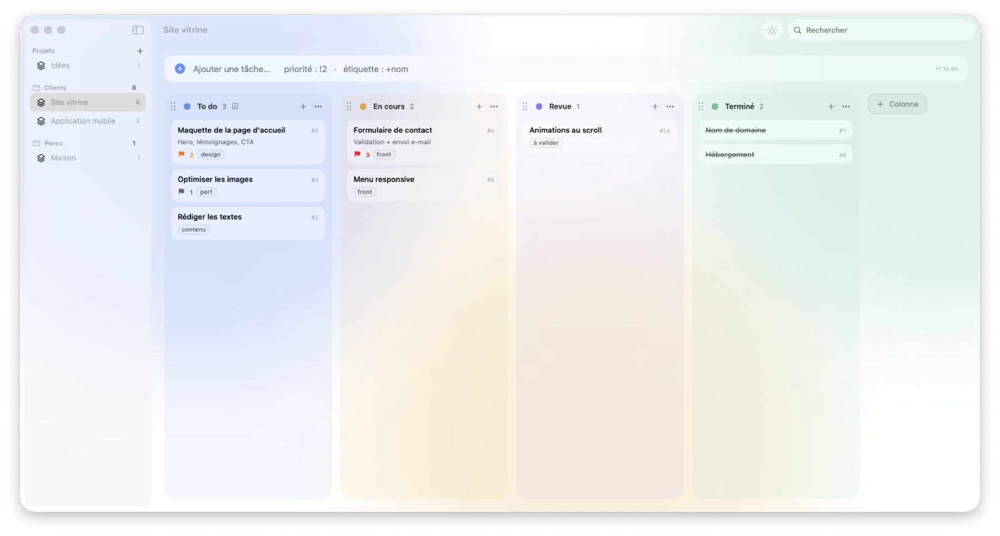

# Kanban

Un kanban pour Mac, que tu peux aussi gérer en parlant à Claude.

<picture>
  <source media="(prefers-color-scheme: dark)" srcset="docs/screenshot-dark.png">
  
</picture>

## Installer

1. Va sur la [dernière version](../../releases/latest) et télécharge le fichier **Kanban-….dmg**.
2. Ouvre-le et glisse **Kanban** dans le dossier **Applications**.
3. Lance Kanban. La première fois, macOS affiche un message d'avertissement : clique **OK**.
4. Ouvre **Réglages Système → Confidentialité et sécurité**, descends tout en bas et clique **Ouvrir quand même**,
   puis confirme. C'est à faire **une seule fois** : ensuite Kanban s'ouvre normalement.

Il faut macOS 26 (Tahoe).

## Connecter Claude

Dans l'app, menu **Kanban** en haut à gauche de l'écran. **Choisis l'une ou l'autre, pas les deux :**

- **Connecter au Chat de Claude…** → si tu utilises Claude dans l'app Claude, onglet **Chat**.
  Quitte ensuite Claude (⌘Q) et rouvre-le.
- **Installer kb pour Claude Code…** → si tu utilises l'onglet **Code** ou Claude dans un terminal.
  C'est la version qui **consomme le moins** (le kanban ne coûte rien tant que tu n'en parles pas).

## Utiliser avec Claude

Parle-lui normalement, par exemple :

- « Ajoute *Relancer le syndic* en priorité 2 avec l'étiquette client »
- « Qu'est-ce qu'il me reste à faire sur le projet Site vitrine ? »
- « Passe la carte 3 en terminé »
- « Crée un projet *Rénovation* dans le groupe Perso »

Le tableau se met à jour tout seul dans l'app.

## Dans l'app

- **Saisie rapide** en haut : tape la tâche puis Entrée. Priorité : `!2` · étiquette : `+nom`
  (exemple : `Relancer le syndic !2 +client`).
- **Projets** à gauche, rangés en **groupes** (glisse un projet sur un autre pour créer un groupe).
- **Colonnes** : clic sur la pastille pour la couleur, poignée ⠿ pour la déplacer, menu ⋯ pour
  « Trier par priorité » ou « Colonne terminée ».
- **Colonnes par défaut** : clic droit sur un projet → « Définir ces colonnes par défaut ».
- Clic droit sur l'icône du Dock : projets récents et nouveau projet. Thème clair/sombre : ⇧⌘D.

Tes données restent sur ton Mac : rien n'est envoyé sur Internet par l'app.

<details>
<summary>Pour les développeurs</summary>

Claude utilise la commande `kb` (sortie très compacte pour économiser les tokens) :

```bash
kb                                   # tableau du projet courant
kb add Relancer syndic !2 +client    # -> id
kb mv 3 done
kb help                              # toutes les commandes
```

Compiler : `./build.sh install` (cette machine) ou `./build.sh release` (DMG universel dans `build/`).

Vérifier un téléchargement : `shasum -a 256 -c Kanban-x.y.dmg.sha256` (fichier fourni avec chaque version).
</details>
